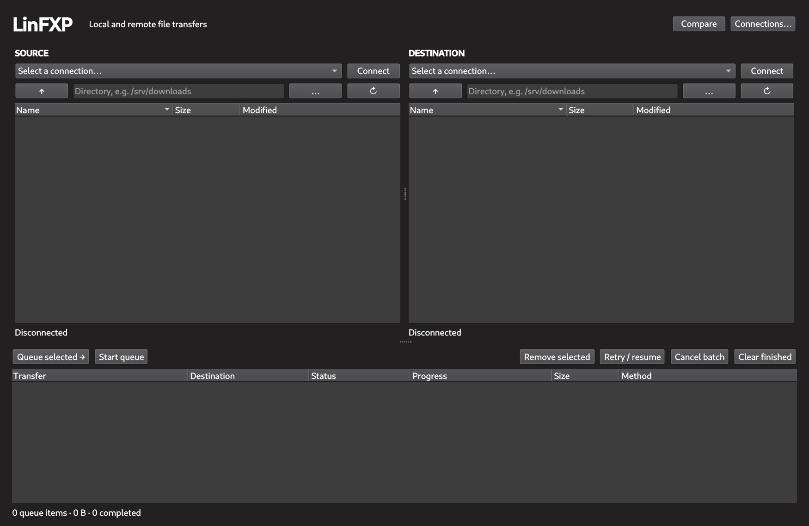

# LinFXP

Move files between remote Linux servers without downloading them to your
desktop first. LinFXP is a native Qt application that lets you browse both
servers, queue files and folders, and monitor direct server-to-server transfers
from one window. Local uploads, downloads, and copies are supported too.



Saved connections, keyring-backed credentials, resumable transfers, and
per-file queue controls make repeated transfers straightforward. Compare the
two displayed listings by filename, or right-click for transfer and browsing
actions.

Server-to-server transfers require SSH access, Python 3, and an OpenSSH client
on the destination, which must be able to reach the source's SFTP service.
These transfers continue after closing LinFXP. Transfers involving your local
computer require only SFTP on the remote server; keep the desktop app open.
Existing destination files are never overwritten.

## Build

Install a C++20 compiler, CMake 3.20+, pkg-config, and the development packages
for Qt 6 (Widgets and Concurrent), libssh 0.11+, and libsecret.

```sh
git clone https://github.com/rabfulton/LinFXP.git
cd LinFXP
cmake -S . -B build -DCMAKE_BUILD_TYPE=Release -DBUILD_TESTING=OFF
cmake --build build --parallel
./build/linfxp
```

Optional system installation:

```sh
sudo cmake --install build --prefix /usr/local
```

Remembering passwords requires a desktop Secret Service keyring. Without one,
uncheck **Remember secret** to keep credentials for the current session only.

To build and run tests, also install Qt 6 Test, Python 3, and Paramiko:

```sh
cmake -S . -B build -DBUILD_TESTING=ON
cmake --build build --parallel
ctest --test-dir build --output-on-failure
```

## Licence

[MIT](LICENSE).
